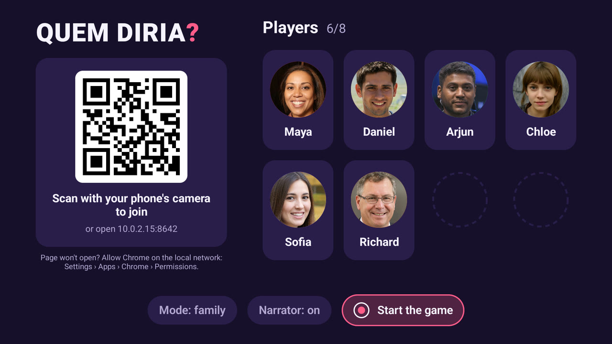
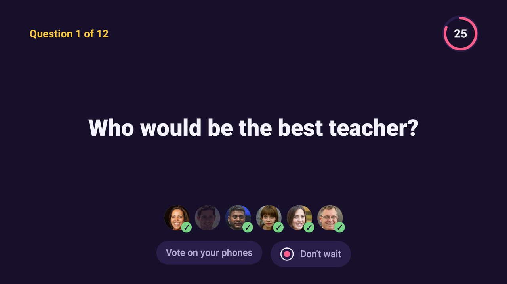
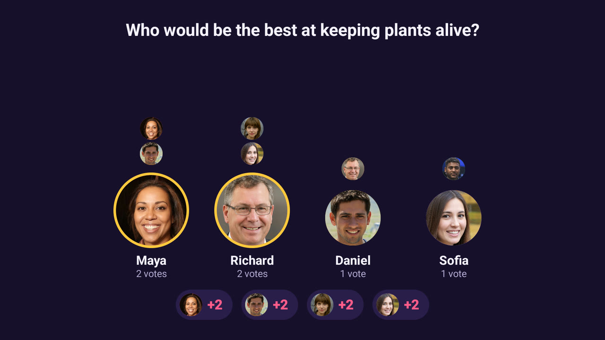
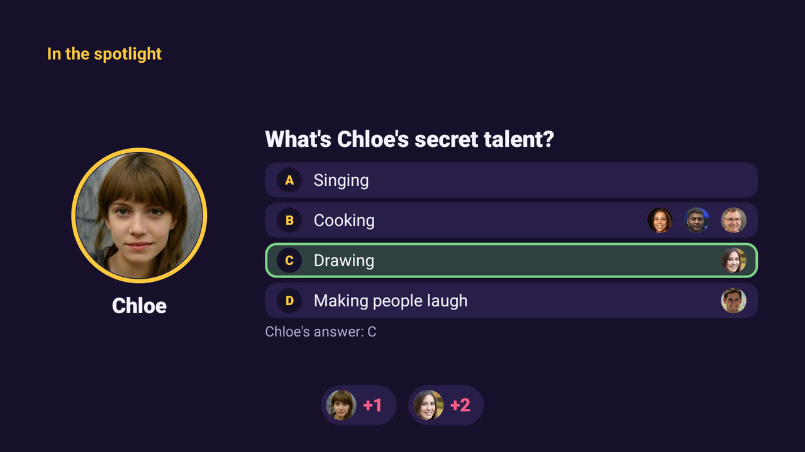
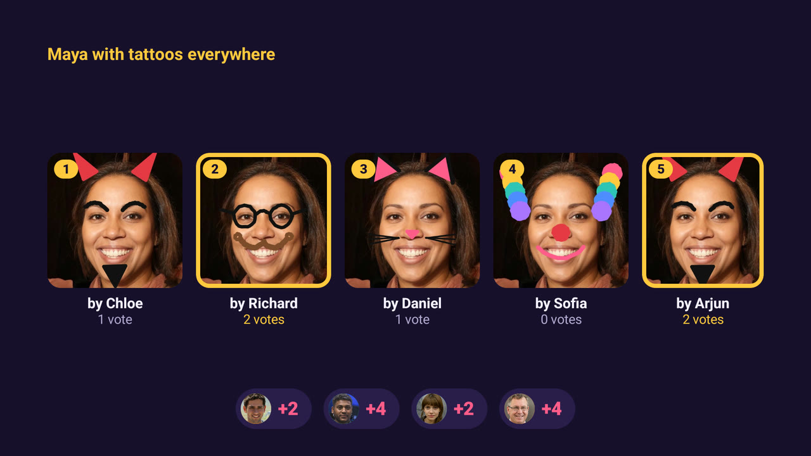
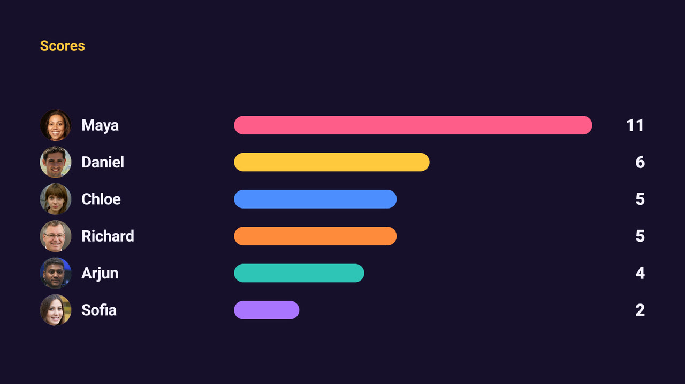
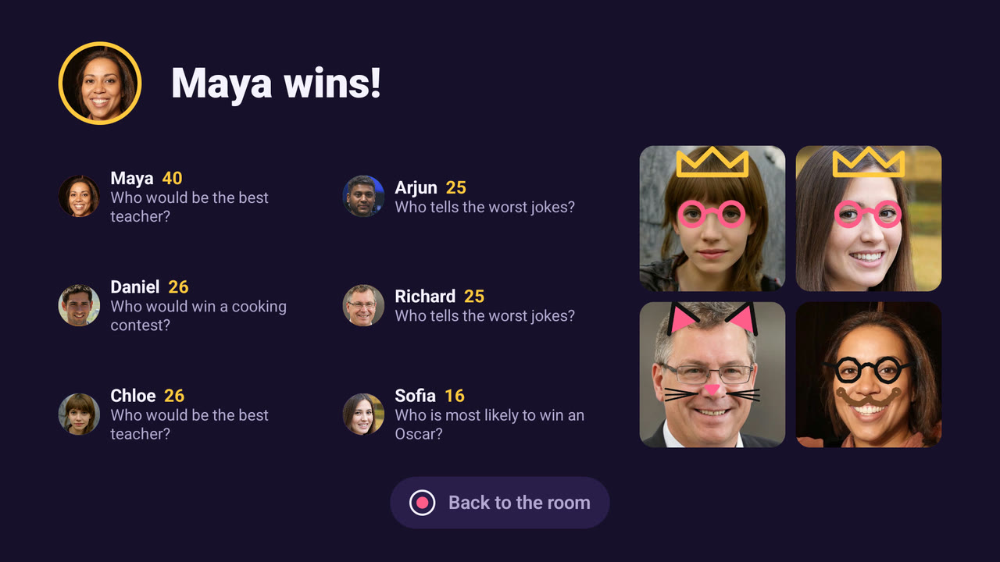
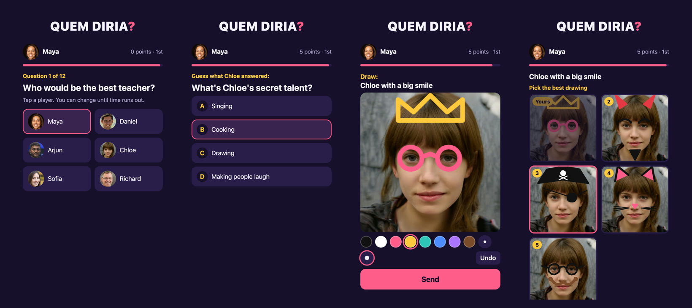

# Quem Diria?

**Who'd have thought?**

A party game for the family TV (Google TV), played with phones. Everyone joins from their phone's browser
by scanning a QR code on the TV, takes a selfie, and then votes in secret on questions about each other:
"who's most likely to...?". You score for agreeing with the rest of the room.

Nothing to install on the phones: the TV app runs a small web server on the home network and the phones
open its page.

Inspired by [That's You!](https://en.wikipedia.org/wiki/That%27s_You!) by Wish Studios for the PlayStation 4.



| | |
|:---:|:---:|
|  |  |
| Everyone votes on their phone | The reveal: you score for agreeing with the room |
|  |  |
| In the spotlight: guess what Chloe answered | Drawing on the spotlight player's selfie |
|  |  |
| The scores | The end: awards and the best drawings |



*The faces are of people who don't exist: AI-generated portraits in the public domain, from
[Wikimedia Commons](https://commons.wikimedia.org/wiki/Category:AI-generated_realistic_faces).*

## Status

**Milestones 1 to 4 are built**; milestone 5 (sharing results with the launcher and Photos TV) is for later.

1. **The room**: QR code, joining, selfies, the TV's lobby.
2. **Voting rounds**: a question, secret votes on the phones, the reveal on the TV, scoring.
3. **Spotlight and drawing rounds**: one player in focus; everyone else draws on their selfie.
4. **Content and polish**: a family deck and an adults deck, end-of-game awards, sounds, the TV reading
   questions aloud.
5. **Later**: results to a family leaderboard in the launcher; the selfie collage to Photos TV.

## A game (about 15 minutes)

- **Votes**: "Who would…?" Everyone votes for a player (themselves included) on their phone. You score 1 point
  for each other player who voted the same way as you.
- **Spotlight**: one player at a time answers a question about themselves (4 choices) and the others guess.
  The **Spotlight** setting picks who gets a turn: **None**, **Moderate** (up to four players, at random; the
  default) or **All** (everyone, a longer game with many players). A right guess is worth 2; the spotlight player gets 1 for each right guess.
- **Drawing**: then everyone else draws on the spotlight player's selfie ("{name} as a pirate"), and all vote
  for the best drawing: 2 points per vote. With only two drawings (three players), the two who drew would only
  have each other's to pick, so only the spotlight player votes.
- **Photos** (when every player is linked to Google Photos): after each spotlight turn, two questions about one
  of that player's photos, shown on the TV: "Where was this photo taken?" or "In what year?". Everyone guesses,
  the player in the photo too, and the photo's own place or date is right: 2 points.
- **Final round**: three last votes, worth double.
- **The end**: the winner, an "award" for each player (the question the room most often picked them for), and
  the best drawings.

## Playing

1. Open Quem Diria? on the TV.
2. Each player scans the QR code with their phone's camera, or opens the address under it.
   Everyone needs to be on the TV's Wi-Fi.
3. Type a name and tap the circle to take a selfie (optional: without one, the TV shows your initial).
4. With 3 to 8 players in, pick **Start the game** with the remote. Left and right also reach **Settings**:
   **Mode** (family / adults), **Narrator** (on / off) and **Spotlight** (none / moderate / all); the TV
   remembers them.

During a game, OK skips the wait ("Don't wait") and Back pauses, offering to leave. Language follows the TV,
phones included, so the whole room plays in one: Portuguese from Portugal, otherwise English.

## Google Photos (optional)

The game plays without it; the photo rounds are only added when it's set up. With
[Photos TV](https://github.com/jjmluz/photos-tv) installed and signed in on the same TV, the lobby has a
**Google Photos** button: pick each player with the remote and who they are among the people Google Photos
recognised (and the family named). The TV asks once whether Quem Diria? may see them. Players are linked again
by name next time. Photos TV does the talking to Google; this app only asks it for people, photos, places and
pictures (`GooglePhotos.kt`). Photos are taken at random from each person's newest few hundred, for now.

Photos can be kept out by person and year in `private/photo-rules.json`, which stays out of git and is bundled
by the build when it's there: `{"<name in Google Photos>": [2012, "2014-2016"]}`, or `[]` for every photo of
someone. A photo is kept out when it's one of that person's, taken in one of those years (others in it aside).
If the file can't be read, no photos are used at all.

## Questions

`app/src/main/assets/decks/family.txt` and `adults.txt`, English and Portuguese side by side on each line
(format at the top of each file and in `Deck.parse`). The adults deck mixes cheeky (dating, drinking, money,
embarrassing stories) and spicy (frank about sex and relationships, with swearing, nothing graphic). Adults
mode plays mostly family questions, with about 30% from the adults deck spread through the game.
**The adults deck is for adults only**: it has swearing and frank questions about sex and relationships. It's
only played when **Mode** is set to **Adults** in the settings (family is the default). The TV
remembers which questions it has played and prefers new ones until it has been through them all.

## Install

Quem Diria? isn't on the Play Store. Download the APK from the
[latest release](https://github.com/jjmluz/quem-diria/releases/latest) and sideload it onto any Android TV or
Google TV device running Android 8 or later. Newer releases install over older ones and keep your settings.

There are two common ways to sideload:

- **From the TV:** install a file manager or downloader app on the TV, open the APK with it, and allow it to
  install unknown apps when asked.
- **From a computer with `adb`:** turn on
  [developer options and USB or network debugging](https://developer.android.com/studio/debug/dev-options) on
  the TV, install the [Android SDK platform tools](https://developer.android.com/tools/releases/platform-tools),
  and run:

  ```bash
  adb connect <tv-ip>:5555
  adb install -r quem-diria-<version>.apk
  ```

### Build it yourself

Needs Android Studio's JDK (21) and the Android SDK; `local.properties` holds the SDK path.

```bash
export JAVA_HOME="/Applications/Android Studio.app/Contents/jbr/Contents/Home"
ANDROID_SERIAL=<tv-ip>:5555 ./gradlew testDebugUnitTest installRelease
```

Install the release build, not the debug build. A release build you make yourself is signed with your own debug
key, so it can't update a copy installed from GitHub (or the other way round). Uninstall one before installing
the other.

GitHub Actions lints, tests and builds on every push and pull request. Pushing a tag like `v1.2.0` builds the
APK with that version, signed with the release key from the repository's secrets, and publishes it on the
[Releases](https://github.com/jjmluz/quem-diria/releases) page.

### Your own music

The build bundles the free tracks in `music/` (see [Music](#music)). To play your own instead, put them in a
`music-custom/` folder at the project root, which stays out of git, named like this:

| File | Plays |
|---|---|
| `lobby.*` | in the room, looping |
| `background_1.*`, `background_2.*`, … | during the game, one after another in a shuffled order |
| `winner.*` | on the final screen, looping |

Any format Android plays works (`.mp3`, `.m4a`, `.ogg`). Each kind you provide replaces the free one, so you
can change only the lobby's music, say, and keep the rest: one `background_*` file of yours replaces all four
free game tracks. Then build and install as above. Your music is only in the APK you build; nothing of it goes
to GitHub.

## Music

The free tracks in `music/` come from [Pixabay](https://pixabay.com/music/) and are used under the
[Pixabay Content License](https://pixabay.com/service/license-summary/), not the MIT License:

## License

Quem Diria?'s code and questions are released under the [MIT License](LICENSE). The music has its own licence:
see [Music](#music).
